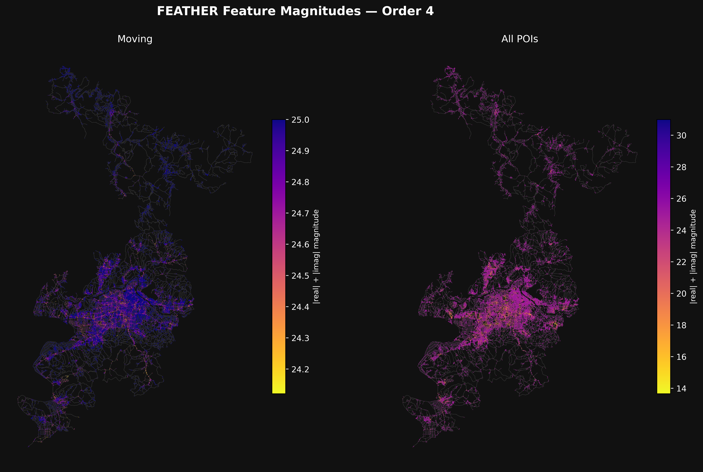

## Reproducible environment with Pixi

This project uses [Pixi](https://pixi.sh/) as the authoritative environment manager.

The environment is configured for:

- `linux-64`
- `win-64`

Python and project dependencies are defined in `pixi.toml`, while `pixi.lock` records the exact resolved environment for reproducibility.

### Install the environment

From the repository root, run:

```bash
pixi install
```

This creates the local Pixi environment in `.pixi/`.

The `.pixi/` directory is generated locally and is not committed to Git.

### Verify the environment

Two lightweight smoke tests are included.

To verify that the main UrbanFeather dependencies and modules import correctly:

```bash
pixi run smoke-imports
```

Expected output:

```text
UrbanFeather imports: OK
```

To verify the three FEATHER weighting modes on the canonical four-node teaching graph:

```bash
pixi run smoke-feather
```

The smoke test checks:

- `FEATHER`: topology-only random-walk probabilities
- `UrbanFEATHER`: inverse-edge-length random-walk probabilities
- `UrbanFEATHER_edgeCost_accessScore`: additive edge-cost + destination-accessibility probabilities
- exact transition matrices for the teaching graph
- transition-row sums
- finite embeddings
- expected embedding dimensions
- invalid `alpha` / `beta` validation
- negative-accessibility validation

The canonical teaching graph is:

```text
A-B = 1
A-C = 3
B-C = 5
B-D = 2
C-D = 1
```

The diagonal `B-C` edge with length `5` is part of the graph.

The smoke-test feature matrix contains two raw accessibility features per node:

```text
School
Shops
```

They are generated with the same teaching setup used by the marimo weighting lab. The default feature rule is the sum of inverse network distances to amenities, so:

```text
closer amenity -> smaller distance -> larger raw X value
```

The smoke test currently uses:

- 4 nodes
- 5 edges
- 2 raw accessibility features
- 3 characteristic-function evaluation points
- random-walk order 2

This gives an embedding dimension of:

```text
2 features x 3 evaluation points x 2 (cosine/sine) x 2 orders = 24
```

and therefore an embedding shape of:

```text
(4, 24)
```

## Experimental transition-weighting modes

The node-level `FEATHER` class now supports three transition weighting modes through `args.weighting_mode`.
These are the only accepted mode strings, and they are case-sensitive.

### 1. FEATHER

```python
args.weighting_mode = "FEATHER"
```

This is the topology-only version. Existing edge weights/lengths are ignored when the transition matrix is built.

For a source node `i`, every connected neighbour receives an equal share:

```text
P(i -> j) = 1 / degree(i)
```

### 2. UrbanFEATHER

```python
args.weighting_mode = "UrbanFEATHER"
```

This preserves the current UrbanFEATHER behaviour.

Each street length is first converted to an inverse-length strength:

```text
edge_strength(i,j) = 1 / length(i,j)
```

The strengths are then normalized across the outgoing neighbours of each source node:

```text
edge_share(i,j)
    = edge_strength(i,j)
      / sum(edge_strength(i,k) for k in neighbours(i))
```

Therefore shorter edges receive a larger random-walk probability.

### 3. UrbanFEATHER_edgeCost_accessScore

```python
args.weighting_mode = "UrbanFEATHER_edgeCost_accessScore"
```

This is an experimental extension. It combines two preferences:

1. relative inverse edge length
2. relative accessibility of the destination node

The edge component is the same normalized inverse-length probability used by UrbanFEATHER:

```text
edge_share(i,j)
```

The destination accessibility score is computed from the ORIGINAL raw feature vector `X`, before theta/cosine/sine encoding.

The current modelling choice is:

```text
access_score(j) = mean(X[j, :])
```

For example, with School and Shops features:

```text
access_score(A) = mean([School_A, Shops_A])
```

This use of the mean is deliberate and simple, but it is a modelling choice rather than a requirement of FEATHER. It can be replaced later if experiments justify a different aggregation rule.

For a source node `i`, destination accessibility is normalized only across nodes directly connected to `i`:

```text
access_share(i,j)
    = access_score(j)
      / sum(access_score(k) for k in neighbours(i))
```

The final transition probability is additive:

```text
A_tilde_new(i,j)
    = alpha * edge_share(i,j)
    + beta  * access_share(i,j)
```

The code uses:

```python
args.edge_alpha = 0.5
args.access_beta = 0.5
```

as the default teaching values for the experimental mode.

**Important:**

```text
alpha + beta MUST equal 1.0
```

Both values must also be non-negative. The implementation raises a `ValueError` if these requirements are not met.

This makes `alpha` and `beta` easy to change while preserving a transition row that can still be interpreted as a probability distribution.

Examples:

```text
alpha = 1.0, beta = 0.0
-> edge cost only

alpha = 0.5, beta = 0.5
-> equal edge-cost and accessibility contribution

alpha = 0.2, beta = 0.8
-> destination accessibility has more influence
```

### Accessibility assumptions

`UrbanFEATHER_edgeCost_accessScore` assumes raw accessibility features are:

- finite
- non-negative
- larger when a node is more accessible / desirable

This works naturally with the current teaching feature rule based on inverse distance.

The original Pandana-generated UrbanFEATHER features appear to encode distance, where a smaller value is better. Those values should therefore be transformed into a higher-is-better accessibility score before using this weighting mode directly.

If all directly connected destination nodes have accessibility score `0`, the accessibility component falls back to the normal UrbanFEATHER edge probabilities for that source-node row.

### Accessibility is used in two places

In the experimental method, accessibility affects the model twice:

1. raw `X` is used to influence where the random walk prefers to move
2. the same raw `X` is transformed into `X0` and propagated as FEATHER information

Conceptually:

```text
raw X
 |\
 | \-> mean accessibility -> access_share --\
 |                                        +--> A_tilde_new
 +-> theta -> cos/sin -> X0              /
                         |               /
                         +-- A_tilde_new --> X1 -> X2 -> ...
```

This is intentional for the experiment, but it can amplify the effect of highly accessible nodes. It should therefore be evaluated with ablations rather than assumed to be automatically better.

### Backwards-compatible default

If `args.weighting_mode` is not supplied, the node-level implementation defaults to:

```text
UrbanFEATHER
```

This preserves the current UrbanFEATHER behaviour for existing callers that only provide:

```python
args.theta_max
args.eval_points
args.order
```

### Example

```python
from types import SimpleNamespace

args = SimpleNamespace(
    theta_max=2.0,
    eval_points=3,
    order=2,
    weighting_mode="UrbanFEATHER_edgeCost_accessScore",
    edge_alpha=0.5,
    access_beta=0.5,
)

model = FEATHER()
model.fit(graph, raw_features, args)
embedding = model.get_embedding()
A_tilde = model.get_transition_matrix()
```

## Marimo

Marimo is available through the Pixi environment for interactive exploration and experimentation.

### `marimo edit` versus `marimo run`

Use `edit` when you want to open the notebook editor, change cells, move through the calculations interactively, and save changes:

```bash
pixi run marimo edit notebooks/marimo/NAME.py
```

Use `run` when you only want to launch the notebook as an app without the editing interface:

```bash
pixi run marimo run notebooks/marimo/NAME.py
```

In short:

```text
marimo edit -> develop and edit the notebook
marimo run  -> use the notebook as an app
```

The Pixi task aliases already defined in `pixi.toml` are also available:

```bash
pixi run marimo-edit
pixi run marimo-run
pixi run weighting-lab
pixi run weighting-lab-run
```

### Marimo notebooks in this project

The `notebooks/marimo/` folder contains:

- `feather_smoke.py` - a minimal notebook that runs a small FEATHER example and displays the embedding.
- `feather_sandbox.py` - an interactive playground for inspecting FEATHER calculations and parameters.
- `urbanfeather_sandbox.py` - a visual explanation of the current inverse-edge-length UrbanFEATHER calculation.
- `feather_vs_urbanfeather_math_lab.py` - a step-by-step mathematical comparison of topology-only FEATHER and UrbanFEATHER.
- `feather_weighting_modes_lab.py` - the new teaching lab comparing `FEATHER`, `UrbanFEATHER`, and `UrbanFEATHER_edgeCost_accessScore`, including `alpha` and `beta`.

The weighting lab uses the same canonical A/B/C/D graph as the smoke test and shows the raw feature matrix, edge-cost share, destination-accessibility share, all three transition matrices, characteristic-function encoding, propagation orders, and final embedding dimensions.

Reusable project logic should remain in regular Python modules under `src/`; marimo is intended as an interactive layer rather than the only location for important implementation logic.

The current FEATHER integration still uses the legacy source layout, so the marimo notebooks adjust `sys.path` to import the bundled FEATHER implementation without refactoring it.

### Python version

The project currently targets Python 3.10.

This was chosen based on the existing notebook metadata in the repository, where Python 3.10 appears repeatedly across the OSMnx, Pandana, and city-based workflows.

### Dependency management

Do not install project dependencies manually with `pip` or create a separate `venv`.

Use Pixi instead.

For example, to add a new dependency:

```bash
pixi add PACKAGE_NAME
```

After changing dependencies, commit both:

```text
pixi.toml
pixi.lock
```

The lockfile should remain under version control because it is what makes the environment reproducible across machines.

### Running Python inside the environment

Python commands should normally be run through Pixi:

```bash
pixi run python your_script.py
```

For example:

```bash
pixi run python src/Utils/OSM2FeatherConverter.py
```

Some of the bundled FEATHER code retains the original script-style import structure and may require its `src` directory to be on the Python import path when imported as part of the larger UrbanFeather project. The included smoke tests handle this explicitly.

### Development principle

The environment setup follows the project principle:

> Reproduce first, improve second.

The current weighting work is isolated behind an explicit `weighting_mode` so the existing UrbanFEATHER behaviour remains available as a baseline while the experimental method is evaluated.

## Acknowledgments

This thesis project builds on the work of Magnus Rolin, Morten Bønneland, Teis Friberg, and Jonas Henriksen, who developed the original project *15-Minute City Accessibility Analysis using FEATHER*.

Their work provided the foundation for the UrbanFeather codebase used and extended in this thesis.

The project also builds on the original FEATHER method by Benedek Rozemberczki and Rik Sarkar.

For citation details of the predecessor project, see the included `CITATION.cff` file.

# Old README.md


This repository contains a research oriented project exploring **accessibility analysis based on the 15-minute city concept**, with a focus on comparing traditional accessibility approched with a FEATHER based approch.

## Problem Statement

The **15-minute city** is an urban planning concept introduced by Carlos Moreno in 2016. It describes a city where residents can access all essential daily services such as work, education, healthcare, shopping, and social activities within a **definitive walking distance** from their home.

The concept emphasises:

- Improved **accessibility**
- Reduced **dependence on cars**
- Increased **social equity**, regardless of mobility or socioeconomic status

In this project, accessibility is defined as the **ability to reach essential services and amenities within a given threshold**, which serves as a continuous value rather than a strict cutoff.

## Project Goal

The goal of this project is to explore and evaluate **new methods for urban accessibility analysis** by leveraging modern graph algorithms specifically the **FEATHER algorithm** and comparing them with established tools such as **GOAT (Geo Open Accessibility Tool)**.

The project aims to deliver a **FEATHER-based solution** capable of processing **OpenStreetMap (OSM)** data to produce accessibility analyses comparable to GOAT’s current capabilities.

## Research Objectives

1. **Comparative Analysis**
   Analyze FEATHER and GOAT for accessibility mapping, focusing on strengths, limitations, and practical differences through case studies or scenarios.

2. **Performance Evaluation**
   Evaluate FEATHER’s performance, robustness, and accuracy when calculating accessibility metrics within an urban environment.

3. **Methodological Extensions**
   Explore potential extensions to existing accessibility measurement methodologies that could be implemented using FEATHER.

## Methodology Overview

- Utilize **OpenStreetMap (OSM)** data as the primary spatial data source
- Apply the **FEATHER algorithm** for graph-based accessibility analysis
- Compare outputs and metrics against those produced by **Pandana**
- Document implementation details, assumptions, and limitations

## Expected Deliverables

- A FEATHER-based accessibility analysis
- Detailed documentation of the methodology and implementation
- Comparative results between FEATHER and PANDANA
- Discussion of limitations and future improvements

## How to run codebase Examples

This example demonstrates how to generate accessibility graph summaries for Daegu, South Korea using OpenStreetMap data.

```bash
#1. Clone the Repository
git clone https://github.com/MRollin03/FGSAM-FEATHER-Graph-summaries-of-accessibility-maps.git

#2. Navigate to the Utility Scripts
cd FGSAM-FEATHER-Graph-summaries-of-accessibility-maps/src/Utils

#3. Run the OSM to Feather Converter
# The following command downloads and processes map data for Daegu, South Korea and stores the generated project files in the projects directory.
```

If you are having trouble with the module utils not getting reconized/found write this command into the terminal

```bash
# make current terminal's python session reconize your internal modules
export PYTHONPATH=$PYTHONPATH:$(pwd)/FEATHER/src
```

>[!NOTE]
>Ensure you have Python and all required dependencies installed before running the script.
>Internet access is required to fetch OpenStreetMap data.
>Large locations may take additional processing time depending on system performance. and Overpass API status

## User Guide

### Automation.sh and or OSM2FeatherConverter.py

`OSM2FeatherConverter.py` handles the full OSM processing pipeline, including querying OpenStreetMap data through the Overpass API, formatting the data, computing FEATHER metrics, and generating plots. But a eaiser way of using it and get a overview would be using the Automation.sh scripts in the Utils directory. src/Utils/Automation.sh

Pipeline overview:

```text
Input -> Overpass API -> Formatting -> FEATHER Computing -> Plotting
```

Run the whole pipine with the bash script.
You can edit diffrent parameters easily in the script.

```bash
bash Automation.sh
```

### Arguments

```bash
--title STR
    Name of the project.

--type STR
    Input mode:
    PLACE        #Use a single place name
    BBOX         #Use a bounding box
    MULTI_PLACE  #Use multiple place names

--bbox FLOAT FLOAT FLOAT FLOAT
    #Bounding box coordinates:
    #west south east north
    #Only used when --type BBOX

--place STR
    #Name of a single location/place.
    #Only used when --type PLACE

--places STR [STR ...]
    #Multiple locations/place names.
    #Only used when --type MULTI_PLACE

--solo STR
    #Process only a single feature/category.
    #If NONE, all categories are processed.

--distance INT
    #Maximum distance used when searching for POIs/Amenities.

--output STR
    #Output directory for the generated project folder.

--pandana BOOL
    #Enable or disable Pandana network calculations.

--order INT
    #FEATHER order value.

--plotorders STR
    #Comma-separated list of plot orders to generate.
    #Example:
    #"1,2,3,4"

--thetamax FLOAT
    #Maximum theta value used in FEATHER calculations.

--evalpoints INT
    #Number of evaluation points used during computation.
```

### Example Usage

#### PLACE mode

```bash
python OSM2FeatherConverter.py \
    --type PLACE \
    --place "Odense Municipality" \
    --title "example_project"
```

#### BBOX mode

```bash
python OSM2FeatherConverter.py \
    --type BBOX \
    --bbox 12.24358 55.91420 12.34091 55.95679 \
    --title "example_project"
```

#### MULTI_PLACE mode

```bash
python OSM2FeatherConverter.py \
    --type MULTI_PLACE \
    --places \
        "Copenhagen Municipality, Denmark" \
        "Frederiksberg Municipality, Denmark" \
    --title "example_project"
```

The options for FEATHER can be found here: https://github.com/benedekrozemberczki/FEATHER/blob/master/README.md

### Graphs

OSM to feather conversion pipeline


## Literature

- Moreno, C. (2021). _Definition of the 15-minute city: What is the 15-minute city?_
  [https://www.researchgate.net/publication/362839186_Definition_of_the_15-minute_city_WHAT_IS_THE_15_MINUTE_CITY](https://www.researchgate.net/publication/362839186_Definition_of_the_15-minute_city_WHAT_IS_THE_15_MINUTE_CITY)

- OpenStreetMap Contributors. _Planet OSM._
  [https://planet.osm.org/](https://planet.osm.org/) (Accessed: 26-01-2026)

- Rozenberczki, B., & Sarkar, R. (2020). _Characteristic Functions on Graphs: Birds of a Feather, from Statistical Descriptors to Parametric Models._
  arXiv:2005.07959, [https://arxiv.org/pdf/2005.07959.pdf](https://arxiv.org/pdf/2005.07959.pdf) (Accessed: 26-01-2026)

## License

This project is intended for academic and research purposes. Licensing details will be added once finalised.

